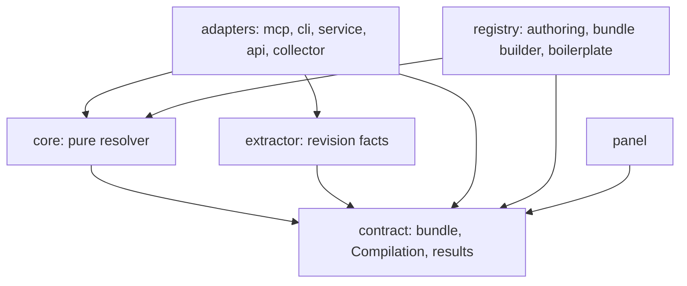
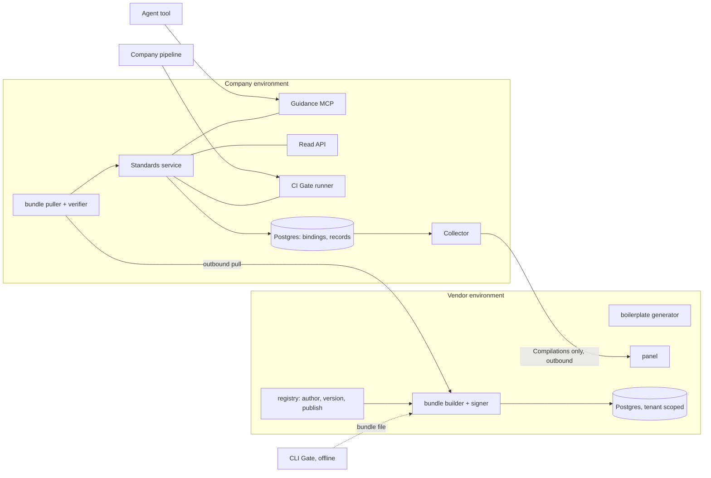
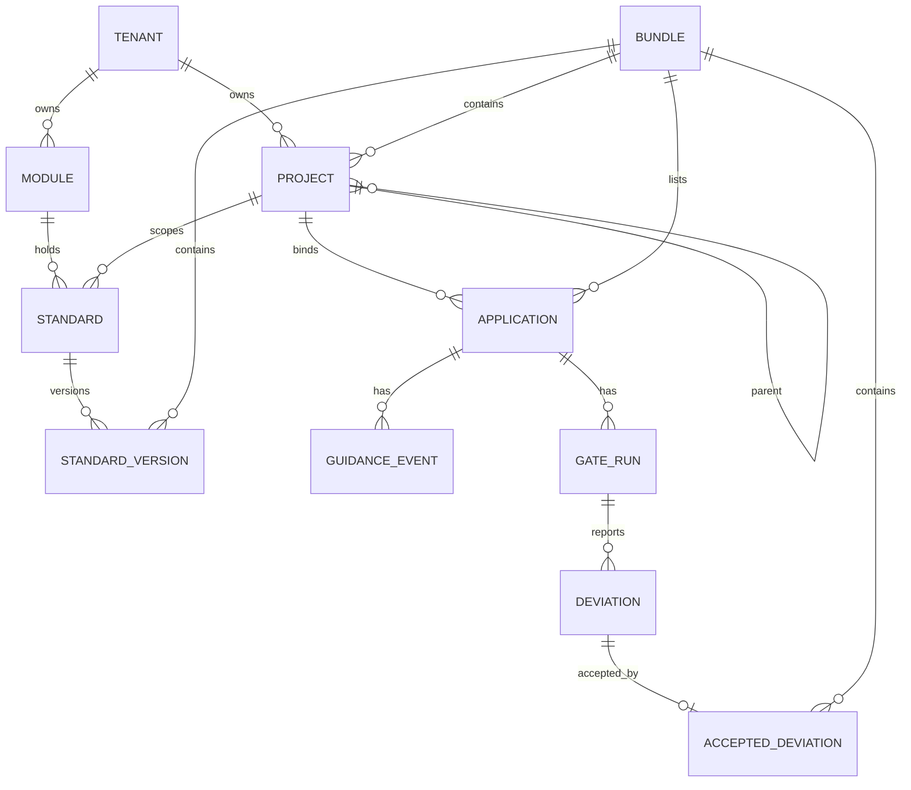

# Architecture Spine — Domain Harness

## Design Paradigm

**Hexagonal.** One pure, I/O-free **resolver core** takes a Project tree, the Application list, Standards, Accepted deviations, a revision's extracted facts and a clock, and returns the Effective Standard set and Deviations. Every surface is a thin adapter around it.

Standards are authored in the vendor registry, compiled into an immutable, signed, hash-addressed **Standard bundle**, and pulled into the Company environment. The bundle is the only way Standard content, the tree, Locked rules and acceptances reach a Gate or Guidance call.

| Layer | Namespace | Holds |
| --- | --- | --- |
| Core | `packages/core` | Tree resolution, precedence, Locked rules, conflict slots, Module checkers, acceptance evaluation. No I/O, no clock reads, no network. |
| Extractor | `packages/extractor` | Deterministic extraction of revision facts (dependency coordinates, import specifiers, tokens) from file contents the adapter supplies. Versioned fact schema. |
| Contract | `packages/contract` | Bundle format, Compilation schemas, tool result types, error envelope. Versioned. |
| Adapters | `apps/*`, `packages/collector` | MCP, CLI, CI step, Company service API, Read API, Collector, registry, panel. |

## Invariants & Rules



Dependency direction is a rule: `core` imports nothing but `contract`; adapters and the registry import `core` and `contract`; the panel imports `contract` only. `extractor` imports `contract` only. The registry imports `core` solely to derive conflict slots, validate publication (AD-13) and resolve for Boilerplate generation (AD-16); it never serves Guidance or a Gate.

### AD-1 — One resolver core, many thin adapters [ADOPTED]

- **Binds:** FR-6, FR-11, FR-13, FR-14, FR-25, NFR-1, NFR-3
- **Prevents:** Guidance, CLI Gate, CI Gate and Read API disagreeing on precedence, Locked rules or conflict slots.
- **Rule:** Effective-set resolution and Deviation evaluation exist only in `packages/core`. No adapter re-implements, caches a derived result across bundles, or post-processes resolution output. Two adapters given the same (bundle hash, extractor version, revision, clock) return the same Deviations.

### AD-2 — The Company environment runs a Company-operated Standards service [ADOPTED]

- **Binds:** FR-11, FR-14, FR-20, FR-25, FR-26
- **Prevents:** Guidance and Gate state scattered across ad-hoc scripts, and a Company port opened toward the vendor.
- **Rule:** Guidance (MCP), the CI Gate runner, the Read API, the bundle cache, the Application binding table and the record store run in one Company-operated service. The Company environment makes only outbound calls to the vendor.

### AD-3 — The vendor registry is authoritative for Standards; content is vendor-held for the pilot [ADOPTED]

- **Binds:** FR-1, FR-4, FR-5, FR-26, NFR-4
- **Prevents:** Two stores each claiming to be the source of a published version, and an unstated change to where Standard content lives.
- **Rule:** Standards, Modules, owners, the Project tree, Locked rules and Accepted deviations are authored and versioned only in the vendor registry and reach the Company environment only as bundles. Company-derived data (source code, prompts, Gate logs, Guidance records) never leaves the Company environment. Company-keyed encryption of Standards is a hardening path, not a pilot behavior (Deferred).

### AD-4 — The registry is built in-house; the bundle format is the integration seam [ADOPTED]

- **Binds:** FR-1, FR-2, FR-3, FR-11
- **Prevents:** An external standards store's data model leaking into resolver semantics.
- **Rule:** Registry, authoring, bundle builder and MCP server are built in this repository. Any later source (an adopted standards tool, Figma sync) integrates by producing a bundle input, never by an adapter reading a foreign model.

### AD-5 — One language, one core [ADOPTED]

- **Binds:** all
- **Prevents:** A second implementation of resolution in another language.
- **Rule:** TypeScript monorepo. No resolution or Gate-check logic is implemented outside `packages/core`. A later Decision agent is a separate service that consumes Guidance outputs and does not resolve Standards itself.

### AD-6 — The Gate is a pure function; mutable state has one owner each [ADOPTED]

- **Binds:** FR-6, FR-10, FR-13, FR-14, FR-15, FR-20, NFR-1, NFR-3, NFR-5
- **Prevents:** An acceptance or tree change reaching the Gate through a side channel, and two owners of one entity.
- **Rule:** A Gate result is a function of (revision facts, extractor version, bundle hash, clock input). Ownership:

| State | Owner | Reaches Gate/Guidance via |
| --- | --- | --- |
| Standards, Modules, owners, Project tree, Locked rules, Applications (id → Project), Accepted deviations | Vendor registry (versioned, append-only) | Bundle only |
| Application id ↔ repository fingerprint binding (trust on first use) | Company service, or a local file for the offline CLI | Local lookup |
| Guidance events, Gate runs, gaps, per-Application sequence | Company service record store (append-only) | Compilations, via AD-9 |

The Project of an Application is derived from the bundle's Application list by Application id. The Project id in the identification file is advisory: a mismatch is reported, never used, and an Application id absent from the bundle yields `unbound`.

### AD-7 — Time is an input, never ambient [ADOPTED]

- **Binds:** FR-15, NFR-1
- **Prevents:** Non-reproducible Gate results and acceptances overstaying their end date.
- **Rule:** The core never reads a clock. The adapter supplies the run time. An Accepted deviation stops applying at its end date by the core's evaluation, with no new bundle required. Determinism holds for a fixed (revision, bundle hash, time).

### AD-8 — The Community CLI Gate runs fully offline [ADOPTED]

- **Binds:** FR-10, FR-13, NFR-5
- **Prevents:** The free Gate behaving differently from the CI Gate, or requiring a service.
- **Rule:** The CLI loads a bundle file, verifies it (AD-11), and keeps the Application id ↔ repository binding in a local file. It uses the same core and enforces the same FR-10 refusals (missing file, id bound to another repository).

### AD-9 — One projection chokepoint to the vendor [ADOPTED]

- **Binds:** FR-20, FR-26, FR-28, NFR-2
- **Prevents:** An adapter building its own payload and leaking prompt text, Standard content or source code.
- **Rule:** Adapters write full records to the Company store only. A single Collector module owns the only function from record to Compilation, built from the published versioned schema. It validates, and drops a failing payload with a visible count. No adapter has a network path to the vendor. A test asserts no sensitive record field can reach a Compilation. A subject crosses only as a slot-name token that matches the slot grammar; free text (for example a design "usage situation") crosses only as a tenant-keyed hash, and raw agent input never leaves the Company environment.

### AD-10 — Collector failure never touches the Builder [ADOPTED]

- **Binds:** FR-26, NFR-2
- **Prevents:** The vendor panel blocking a Guidance call or Gate run, and silent loss of join rows.
- **Rule:** The Collector buffers in a durable local queue and retries when the panel is unreachable. The Buyer view shows the pending count. A Collector error never fails or delays a Guidance call or Gate run.

### AD-11 — Bundles are signed and verified before load [ADOPTED]

- **Binds:** FR-1, FR-14, NFR-1, NFR-3
- **Prevents:** A tampered or substituted bundle deciding what ships.
- **Rule:** The registry signs each bundle. The signed payload includes the tenant id, a per-tenant monotonic sequence number and the key id. The service and CLI verify signature, a key id in their configured trust set, tenant match and hash, and refuse a bundle whose sequence is lower than the active one. Key rotation overlaps by key id. The bundle hash is the identity quoted in every Guidance response, Gate run and Compilation.

### AD-12 — Tenant scope is mandatory in the data layer [ADOPTED]

- **Binds:** FR-5, NFR-4
- **Prevents:** One Company reading another's Standards, Projects, Applications or Compilations.
- **Rule:** One shared Postgres for the pilot. No query path exists without a tenant id supplied by the access layer, and row-level security is a second guard. A dedicated environment is an Enterprise-tier concern (Deferred).

### AD-13 — One live Standard per slot per scope

- **Binds:** FR-2, FR-3, FR-6
- **Prevents:** The resolver or two adapters breaking a same-scope tie differently.
- **Rule:** Any registry mutation (publish, re-parent, acceptance, Application change) validates the whole proposed bundle before it is accepted. It rejects a second live Standard in the same conflict slot at the same Project scope, across Modules, and a descendant Locked rule that contradicts an ancestor's Locked rule. A slot is the tuple (Module kind, slot kind, name), so equal names in different kinds never compete. The core may assume uniqueness per (slot, scope) and raises an error, not a guess, on a violation.

### AD-14 — Activation is an atomic pointer; every call pins a bundle

- **Binds:** FR-1, NFR-3
- **Prevents:** A request or run mixing fields from two versions, and "version in force" meaning different things per surface.
- **Rule:** The service holds one active-bundle pointer, swapped atomically after AD-11 verification. Every Guidance call and Gate run pins the bundle hash at start and records it. The pointer lives in the Company record store, never in process memory, so replicas agree. The panel shows each service's active hash, sequence and staleness.

### AD-15 — Guidance results are typed; the service records misses

- **Binds:** FR-11, FR-22, NFR-5
- **Prevents:** Two tools returning "not found" differently, and gaps depending on the agent to report.
- **Rule:** Every Guidance tool returns exactly one of `hit` (Standard id, version, content), `miss` (subject) or `unbound`. The service, not the agent, persists a gap on `miss`. Tool names and inputs follow FR-11 and are versioned in `contract`.

### AD-16 — Boilerplate generation belongs to the registry

- **Binds:** FR-8, FR-9, FR-10
- **Prevents:** The core or an adapter growing project-generation logic, and two sources minting Application ids.
- **Rule:** The registry generates the Boilerplate and mints the Application id and Project identification file content. It resolves through `core` on registry data, is delivered as a repository archive, and is not an adapter on the core. The file carries the Application id and an advisory Project id.

### AD-17 — Service identity is per tenant; roles live in the registry

- **Binds:** FR-4, FR-7, FR-15, FR-28, FR-29
- **Prevents:** Role checks duplicated in the Company service and a shared credential across Companies.
- **Rule:** The Company service authenticates to the registry with a per-tenant credential for bundle pull and Compilation push. Buyer, Standard owner and Builder roles are enforced in the registry and panel. The Company service enforces only what a bundle and a binding permit, plus role-gated reads of Guidance events (FR-28) on short-lived, tenant-scoped role tokens the registry issues. FR-15 alerts are evaluated and delivered by the registry, never by the Company service.

### AD-18 — One extractor, versioned facts

- **Binds:** FR-2, FR-3, FR-13, FR-14, NFR-1
- **Prevents:** CLI and CI runner each parsing lockfiles and imports differently, so one passes what the other fails.
- **Rule:** Revision-fact extraction lives only in `packages/extractor`. It is a deterministic function of file contents the adapter supplies and emits a versioned fact schema. The extractor version is recorded on every Gate run and is part of the determinism tuple in AD-1. The core accepts facts only in that schema.

### AD-19 — Repository identity: network trust plus fingerprint [ADOPTED]

- **Binds:** FR-10, FR-11, NFR-5
- **Prevents:** Each surface inventing its own way to decide which Application a caller is.
- **Rule:** The Company service is reachable only inside the Company network. The Application id comes from the identification file. The repository fingerprint is SHA-256 of the root commit SHA (`git rev-list --max-parents=0 HEAD`); the remote URL is not used. Guidance receives both as `X-DH-Application-Id` and `X-DH-Repo-Fingerprint` headers. They are computed at call time by a stdio MCP bridge shipped in the Boilerplate (`@domain-harness/mcp-bridge`), which forwards to the service over Streamable HTTP. The CI step and the CLI compute the same values. Header names and the fingerprint algorithm are versioned in `contract`. On first use the service (or the CLI's local file) binds the id to the fingerprint, and a different fingerprint presenting a bound id is refused as a Compilation-visible refusal. Every surface uses this one check. A repository with no commit yields `unbound`. Forks share a root commit; this is an accepted pilot risk. Per-Application tokens are a hardening path (Deferred).

### AD-20 — Compilations are a closed catalog with idempotency and one ordering

- **Binds:** FR-20, FR-21, FR-22, FR-23, FR-26, NFR-2
- **Prevents:** Panel metrics that cannot be derived from what crosses, and join rows duplicated or misordered across environments.
- **Rule:** The Compilation catalog in `contract` is closed: Guidance, Gate run, Deviation, Binding refusal, Bundle status (active hash, sequence, staleness), Collector health (pending, dropped by reason). Every Compilation carries a UUIDv7 idempotency key, the Application id and a per-Application sequence number assigned by the Company record store (or CLI local file). "A revision after that event" in FR-23 is evaluated by that sequence, never by commit ancestry or by comparing host clocks. A Gate-run Compilation carries checked and open counts so Adherence is derivable. A panel metric that is not derivable from the catalog is not built until the catalog gains a type (semver bump).

### AD-21 — Stale means fail closed past a bound [ADOPTED]

- **Binds:** FR-1, FR-14, NFR-3, NFR-5
- **Prevents:** A stale service silently passing what a newer Standard or revoked acceptance would fail.
- **Rule:** The service records the age of the active bundle. Past the Buyer-set bound (default 24h), the CI Gate returns an explicit `stale` result with a non-zero exit, never a pass. Guidance keeps serving the active bundle and flags every response stale. The Buyer can set an explicit, recorded freeze that suspends the bound. The CLI Gate checks the bound against the bundle file's issue time with the same rule.

### AD-22 — Guidance-record reads stay in the Company environment [ADOPTED]

- **Binds:** FR-20, FR-26, FR-28, NFR-9
- **Prevents:** The panel growing a path to Company-held Guidance content, and the role check living in two places.
- **Rule:** Stored Guidance-event content is read only through a Company service endpoint inside the Company network. The endpoint requires a short-lived, tenant-scoped role token issued by the registry (AD-17), whose role holds the Buyer's FR-28 grant. The panel configures the grant and shows Compilation-derived evidence only. It never proxies, caches or renders Guidance content. Retention (default 90 days, Company-configurable) is enforced by the service on its own store.

## Consistency Conventions

| Concern | Convention |
| --- | --- |
| Naming | Packages `@domain-harness/{core,contract,collector}`. Apps `registry`, `panel`, `service`, `cli`. Guidance tools `snake_case` as in FR-11. |
| Identifiers | Opaque UUIDv7, minted by the registry for Application, Project, Standard, Module. Never client-generated. |
| Time | UTC ISO-8601 on the wire and in records. |
| Schemas | Bundle, fact schema and every Compilation type carry an explicit semver and a type name. A consumer rejects an unknown major and reports its own version to the panel. |
| Errors | One envelope: `code`, `message`, `subject`. Never a bare string, never a partial success. |
| Deviation match key | (Standard id, conflict slot, subject), as the Glossary defines it. An acceptance is keyed by (Application id, Standard id, Standard version, conflict slot, subject). Built in `core` only. |
| Logging | Records hold what the Company store may hold; logs and metrics exported from the service carry ids and counts, never subject text from prompts. |

## Stack

| Name | Version |
| --- | --- |
| Node.js | 26 LTS target (scheduled 2026-10-28), `engines >=24` (24 Active LTS until 2026-10-20) |
| TypeScript | 7.0.2 (native compiler) for build and typecheck; 6.0.3 through an npm alias for compiler-API tooling (typescript-eslint, dependency-cruiser) until 7.1 ships the API. Decided 2026-10-10; see `docs/decisions/starter-template.md` |
| @modelcontextprotocol/server | 2.x (npm `latest` 2.3.1), behind the MCP adapter. Decided 2026-10-10, replacing `@modelcontextprotocol/sdk` 1.x; see `docs/decisions/starter-template.md`. Guidance is served over Streamable HTTP |
| PostgreSQL | 18 (the application database role must not own the tables, or row-level security is bypassed) |
| CI Gate target | GitHub Actions (pilot) |
| Panel sign-in | Passwordless magic link (email delivery provider chosen at scaffold) |

Web framework, ORM, test runner and monorepo tool are chosen at scaffold (Deferred).

## Structural Seed





```text
domain-harness/
  packages/
    core/        # pure resolver, Module checkers, acceptance evaluation
    extractor/   # revision facts from file contents, versioned fact schema
    contract/    # bundle format, Compilation schemas, tool results, errors
    collector/   # record -> Compilation projection, durable queue
  apps/
    registry/    # authoring, bundle builder + signer, boilerplate (vendor)
    panel/       # Adherence, gaps, inventory, cross-checks (vendor)
    service/     # Guidance MCP, CI Gate runner, Read API, puller (Company)
    cli/         # offline Gate (Community)
```

Operational envelope for the pilot: vendor side is one region, managed Postgres, containers, and dev/staging/prod. Company side is one container image plus its own Postgres, delivered by compose or Helm. Secrets (service credentials, signing keys) come from the environment or a secret manager and never from a repository. The record store and the Collector queue are backed up by the Company. Loss of the queue is visible as a Collector-health gap, not silent. Provider choice, service levels and disaster recovery are Deferred.

## Capability → Architecture Map

| Capability / Area | Lives in | Governed by |
| --- | --- | --- |
| Standard Registry (FR-1–4) | `apps/registry`, `packages/contract` | AD-3, AD-4, AD-12, AD-13, AD-17 |
| Project Tree (FR-5–7) | `apps/registry` (authoring), `packages/core` (resolution) | AD-1, AD-3, AD-13 |
| New-Application Flow (FR-8, FR-9) | `apps/registry` | AD-16, AD-3 |
| Project identification (FR-10) | `packages/core`, `apps/service`, `apps/cli` | AD-6, AD-8, AD-19, NFR-5 |
| Guidance (FR-11) | `apps/service` MCP adapter | AD-1, AD-14, AD-15 |
| Gate (FR-13–15) | `packages/core`, `packages/extractor`, `apps/service`, `apps/cli` | AD-1, AD-6, AD-7, AD-8, AD-11, AD-18, AD-21 |
| Intelligence (FR-20–23) | `packages/collector`, `apps/panel` | AD-6, AD-9, AD-10, AD-20 |
| Standards API (FR-25) | `apps/service` | AD-1, AD-14 |
| Deployment boundary (FR-26–28) | `packages/collector`, `apps/service` | AD-2, AD-3, AD-9, AD-10 |
| Access (FR-28, FR-29) | `apps/registry`, `apps/panel`, `apps/service` | AD-17, AD-12, AD-22 |

## Deferred

| Decision | Why it can wait / revisit when |
| --- | --- |
| Company-keyed encrypted Standards (hardening of AD-3) | Pilot proves value first. Revisit on the first regulated-sector security review. |
| Web framework, ORM, test runner, monorepo tool | Not cross-unit invariants. Choose at scaffold; any choice must respect the dependency diagram. |
| Cloud provider, SLOs, availability, DR | PRD OQ8, required before an enterprise SLA, not the pilot. |
| SSO/SCIM | Outside first cut (FR-29). Roles stay in the registry (AD-17). |
| Decision agent placement and its evaluation harness | Out of first cut (FR-12). It must consume Guidance output only (AD-5). |
| Impact analysis, batch acceptance (FR-16–18) | Out of first cut. Bundle content is the seam: an acceptance change already means a new bundle (AD-6). |
| Tools without a repository (PRD OQ2) | Read API is the likely feed. Revisit when a channel is defined. |
| Compilation fields beyond FR-26 (PRD OQ5) | Needs a security review. Adding a field requires a schema semver bump (AD-9). |
| Lineage and Information-source Module | Out of first cut (FR-24). |
| Signing key custody and revocation tooling | Needs a chosen KMS/provider. Revisit with the provider decision. Key id, trust set and sequence rules in AD-11 stay. |
| Per-Application tokens or per-Builder SSO (hardening of AD-19) | Pilot runs on network trust plus fingerprint. Revisit on the first security review that rejects it. |

## PRD amendments required

- FR-26 and §8: Standard content is vendor-held for the pilot (AD-3). Gate logs, Guidance records, code and prompts remain Company-environment only.
- FR-10: the Project is resolved from the signed bundle by Application id, not from the file. The file carries the Application id; its Project id is advisory (AD-6).
- FR-15 and the Glossary "match key": an acceptance is scoped to (Application, Standard, version, slot, subject) (Conventions).
- FR-26: the Compilation field list is extended by the catalog in AD-20 (Bundle status, Collector health, per-Application sequence, idempotency key, Gate counts). Subject crosses only as a slot token or hash (AD-9).
- FR-1 "version in force": means the active bundle (AD-14), bounded by AD-21.
- PRD Open Question 10 is resolved as *build* (AD-4).
